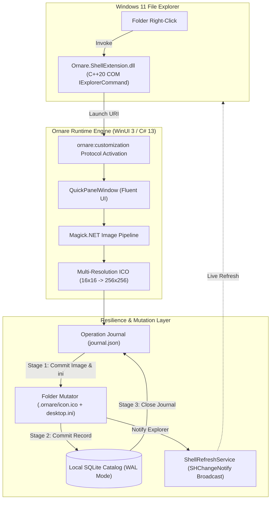
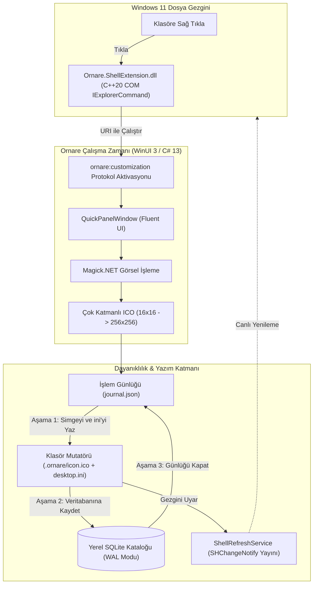

<div align="center">

# 🎨 Ornare — Windows 11 Klasör Simgesi & Tasarım Özelleştirici

</div>

---

<div align="center">

[](#english-version)
&nbsp;&nbsp;&nbsp;&nbsp;
[](#turkish-version)

</div>

---

<div align="center">


-0078D6?style=for-the-badge&logo=windows&logoColor=white)


</div>

---

<a id="english-version"></a>
# English Version

<div align="center">
  
  <h3>Ornare — Windows 11 Native Folder Customization & Icon Architecture</h3>
  <p><em>Premium, Local-First, Zero-Telemetry Folder Customizer with Modern Shell Extension & Fast Application Engine</em></p>
  <p><strong>Developed & Published by <a href="https://vellium.dev">Vellium</a></strong></p>
</div>

<br>

## 💻 Project Overview

**Ornare** is an enterprise-grade, specification-first Windows 11 utility engineered to personalize folder icons with effortless speed, cryptographic resilience, and native platform integration. Its core interaction promise is seamless:

> **Right-click any folder → Select "Set Folder Icon" → Drop, pick, or paste an image → Done instantly.**

Unlike legacy icon tools that rely on web views, unstable registry hacks, or brute-force Explorer process termination, Ornare is built entirely with **WinUI 3 (Windows App SDK 1.6+)**, **.NET 10 (C# 13)**, and **native C++20**. It integrates directly with the modern Windows 11 File Explorer context menu via an out-of-process COM `IExplorerCommand` shell extension.

Ornare features a **Durable Operation Journal** and **Idempotent Reconciliation Engine**: custom icon assignments never corrupt existing folder contents or overwrite custom user `desktop.ini` configurations. It runs **100% offline** with zero telemetry, zero analytics, zero external network calls, and zero background ads.

---

## 🚀 Key Features

- **Native Windows 11 Context Menu**: Directly accessible from File Explorer via an out-of-process, fail-safe C++20 COM `IExplorerCommand` extension.
- **Zero-Restart Live Shell Refresh**: Changes apply immediately across all open Explorer windows and the Desktop via native `SHChangeNotify` notification broadcasts without ever killing or restarting `explorer.exe`.
- **Durable Relative Icon Storage**: Icons are converted into high-fidelity multi-resolution `.ico` packages and stored in durable hidden subdirectories (`.ornare/icon.ico`) using relative paths—ensuring folder icons remain intact even when directories are renamed or moved across drives.
- **Durable 2-Phase Journal & Reconciliation**: Filesystem mutations and SQLite state updates are protected by a transactional write-ahead operation journal (`journal.json`). Any system crash or power outage during an operation is automatically reconciled on the next launch.
- **Safe Reset & Non-Destructive Rollback**: Reverting a folder removes only Ornare-owned icon semantics, preserving all existing third-party or operating system attributes in `desktop.ini`.
- **Multi-Format Image Pipeline**: Powered by Magick.NET, supporting PNG, JPEG, WebP, BMP, and SVG files. Automatically scales and packages icons into 16x16, 24x24, 32x32, 48x48, 64x64, 128x128, and 256x256 multi-layer ICO archives with crisp downsampling and alpha-channel preservation.
- **Compact Quick Panel & Manager UI**: Minimalist, card-free WinUI 3 interface adhering strictly to Microsoft Fluent 2 design principles, supporting system theme synchronization (Dark / Light) and high-contrast modes.
- **Multi-Architecture Support**: Built and qualified for **x64** and **ARM64** on Windows 11 (24H2, 25H2, and 26H1).
- **100% Bilingual (English & Turkish)**: Fully localized UI, context menus, installer, and error diagnostics based on system UI language.
- **Privacy & Security First**: Strictly local-first. No accounts, no cloud dependencies, no image telemetry, and no hidden administrator requirements.

---

## 🛠️ Tech Stack

<div align="center">


</div>

### Shell Extension & Native Core (C++20)
- **COM `IExplorerCommand`**: Out-of-process Windows 11 modern context menu integration (`Ornare.ShellExtension.dll`).
- **Win32 Shell & Security API**: `SHChangeNotify`, folder attribute management (`FILE_ATTRIBUTE_SYSTEM` / `READONLY`), and ACL preservation.
- **Native Bootstrapper Installer**: High-performance Win32 C++ installer (`OrnareSetup.exe`) embedding signed MSIX payloads with automatic certificate configuration.

### Application & Design System (C# 13 & WinUI 3)
- **WinUI 3 & Windows App SDK 1.6**: Hardware-accelerated Fluent 2 user interface (Quick Panel & Library Manager).
- **Ornare.DesignSystem**: Custom control primitives, Mica/Acrylic backdrops, accessible typography, and keyboard navigation.
- **Magick.NET (Q16-AnyCPU)**: Production image decoding, sanitization, SVG rasterization, and multi-layer ICO encoding.
- **Microsoft.Data.Sqlite**: Local database with Write-Ahead Logging (WAL) for tracking customized folders and undo history.

---

## 📁 Project Structure

```tree
Ornare/
├── .agents/                        # AI development workflows, rules & domain skills
├── docs/                           # Specifications, logic invariants & ADRs
│   ├── adr/                        # Architecture Decision Records
│   ├── LOGIC_INVARIANTS.md         # Invariants & rollback integrity rules
│   ├── QUALITY_GATES.md            # Enterprise quality gates & criteria
│   └── REQUIREMENTS_TRACEABILITY.md# Full requirements mapping
├── production_artifacts/           # Release candidates, WACK reports & branding
│   ├── branding/                   # Vector logos, icons & presentation graphics
│   └── release/                    # Certificates, checksums & store metadata
├── scripts/                        # Automation & verification scripts
│   ├── build-multiarch-release.ps1 # Multi-arch packaging, PRI indexing & signing
│   ├── setup-dev-certificate.ps1   # Local cert trust setup
│   └── verify.ps1                  # Comprehensive engineering verification
├── src/                            # Application and core component source
│   ├── Ornare.App/                 # WinUI 3 desktop application (Quick Panel & Manager)
│   ├── Ornare.Core/                # Domain models, operations & contracts
│   ├── Ornare.DesignSystem/        # Premium Windows 11 WinUI styles & controls
│   ├── Ornare.Imaging/             # Multi-layer ICO encoder & Magick.NET image pipeline
│   ├── Ornare.Installer/           # Native C++ Win32 bootstrapper & standalone setup
│   ├── Ornare.Package/             # MSIX packaging assets & AppxManifest
│   ├── Ornare.ShellExtension/      # C++20 IExplorerCommand Windows 11 shell integration
│   ├── Ornare.Storage/             # SQLite database, journal & reconciliation engine
│   └── Ornare.Windows/             # Windows Shell APIs, desktop.ini & refresh services
├── tests/                          # Automated unit, integration and UI test suites
│   ├── Ornare.Core.Tests/          # Core model & serialization tests
│   ├── Ornare.Imaging.Tests/       # Image processing, ICO generation & SVG tests
│   ├── Ornare.IntegrationTests/    # End-to-end folder customization & persistence tests
│   ├── Ornare.Storage.Tests/       # SQLite journaling, crash-recovery & rollback tests
│   └── Ornare.UiTests/             # UI smoke, window management & layout tests
├── Ornare.slnx                     # Solution configuration file
└── README.md                       # Master Documentation
```

---

## 🔐 Architecture & Invariants



### Safety Invariants

| Invariant | Implementation Mechanism | Safety Guarantee |
| :--- | :--- | :--- |
| **Explorer Stability** | Out-of-process COM + `SHChangeNotify(SHCNE_UPDATEITEM)` | Explorer process is never killed or restarted. |
| **Data Preservation** | Non-destructive `desktop.ini` parsing & relative paths | Existing folder contents and non-Ornare customizations are preserved. |
| **Crash Recovery** | 2-phase write-ahead journal (`journal.json`) | Interrupted or aborted file writes are cleanly rolled back or replayed on reboot. |
| **Offline Privacy** | Zero network sockets in source code | No images, file paths, or telemetry are ever transmitted outside the machine. |

---

## ⚙️ Installation & Usage

### Prerequisites
- **Operating System**: Windows 11 Version 24H2 or later (x64 or ARM64)
- **Developer Tools**: .NET 10 SDK, Visual Studio 2022 / 2026 Build Tools (C++ Desktop Workload), Windows 11 SDK (10.0.26100.0+)

### Step-by-Step Developer Setup

1. **Clone the Repository:**
   ```bash
   git clone https://github.com/emirtdede/Ornare.git
   cd Ornare
   ```

2. **Restore & Verify Solution:**
   ```bash
   dotnet restore Ornare.slnx --locked-mode
   ```

3. **Run Automated Test Suites:**
   ```bash
   # Run all 89 unit, storage, imaging, UI and integration tests
   dotnet test Ornare.slnx -c Release
   ```

4. **Build Production Release Artifacts:**
   ```bash
   # Multi-architecture automated pipeline (Build -> PRI Indexing -> Pack -> Sign -> Audit)
   powershell.exe -NoProfile -ExecutionPolicy Bypass -File scripts/build-multiarch-release.ps1
   ```

---

## 📦 Pre-Compiled Distribution Packages

Ready-to-use production packages are located inside [`production_artifacts/release/candidate/`](file:///c:/Users/emir/Desktop/Ornare/production_artifacts/release/candidate):

- **OrnareSetup.exe**: Standalone Win32 bootstrapper with embedded signed MSIX payload and 1-click certificate configuration.
- **Ornare_1.0.0.0_x64.msix**: Standard x64 signed application package for Windows 11.
- **Ornare_1.0.0.0_arm64.msix**: Native ARM64 signed application package for Copilot+ PCs and ARM64 hardware.
- **Ornare_1.0.0.0_x64_arm64.msixbundle**: Unified multi-architecture distribution bundle.
- **SHA256SUMS.txt**: Cryptographic checksum manifests for package validation.

---

## ⚖️ License

Copyright © 2026 **Vellium**. All rights reserved.

Original source code, branding, visual identity, and product design are proprietary property of Vellium. Distributed under the terms of the project license agreement. See [`LICENSE.md`](file:///c:/Users/emir/Desktop/Ornare/LICENSE.md) and [`THIRD-PARTY-NOTICES.md`](file:///c:/Users/emir/Desktop/Ornare/THIRD-PARTY-NOTICES.md) for full licensing details.

**Official Website**: [Vellium.dev](https://vellium.dev) &bull; **Publisher**: Vellium

---

<br>

---

<a id="turkish-version"></a>
# Türkçe Versiyon

<div align="center">
  
  <h3>Ornare — Windows 11 Yerel Klasör Simgesi ve Tasarım Özelleştirici</h3>
  <p><em>Modern Dosya Gezgini Entegrasyonuna Sahip, %100 Yerel, Sıfır Telemetrili Premium Klasör Kişiselleştirme Aracı</em></p>
  <p><strong>Geliştirici ve Yayıncı: <a href="https://vellium.dev">Vellium</a></strong></p>
</div>

<br>

## 💻 Proje Genel Bakışı

**Ornare**, Windows 11 kullanıcılarının klasör simgelerini en hızlı, en güvenli ve modern işletim sistemi standartlarına tam uyumlu şekilde kişiselleştirmesini sağlayan kurumsal düzeyde yerel bir masaüstü uygulamasıdır. Temel kullanım vaadi son derece yalındır:

> **Herhangi bir klasöre sağ tıklayın → "Klasör Simgesini Ayarla"yı seçin → Bir görseli sürükleyin, seçin veya yapıştırın → Anında hazır.**

Web tabanlı hantal arayüzler kullanan, registry kayıtlarını bozan veya simgeleri yenilemek için Windows Gezgini'ni (`explorer.exe`) zorla yeniden başlatan geleneksel araçların aksine Ornare; **WinUI 3 (Windows App SDK 1.6+)**, **.NET 10 (C# 13)** ve **yerel C++20** teknolojileriyle geliştirilmiştir. Windows 11'in modern sağ tık menüsüne doğrudan harici COM `IExplorerCommand` uzantısıyla entegre olur.

Ornare, **Dayanıklı İşlem Günlüğü (Durable Journal)** ve **Idempotent Senkronizasyon Motoru** içerir: Simge uygulama veya sıfırlama işlemleri hiçbir zaman klasör içeriğini bozmaz, üçüncü taraf `desktop.ini` yapılandırmalarını ezmez. Uygulama **%100 çevrimdışı** çalışır; telemetri, analitik, harici ağ istekleri ve reklam barındırmaz.

---

## 🚀 Önemli Özellikler

- **Windows 11 Modern Sağ Tık Menüsü**: Dosya Gezgini üzerinden süreç dışı (out-of-process) çalışan, çökmelere karşı korumalı C++20 COM `IExplorerCommand` kabuk uzantısıyla anında erişim.
- **Yeniden Başlatmasız Canlı Tazeleme**: Gezgin sürecini (`explorer.exe`) asla kapatıp açmadan, yerel `SHChangeNotify` API çağrılarıyla masaüstü ve tüm açık klasör pencerelerinde simgeleri anında günceller.
- **Bağıl ve Dayanıklı Simge Depolaması**: Görseller yüksek kaliteli çok katmanlı `.ico` formatına dönüştürülüp klasörün kendi içindeki gizli `.ornare/icon.ico` dizininde bağıl (relative) yolla tutulur. Klasör adı değiştirildiğinde veya başka diske taşındığında simge kaybolmaz.
- **2 Aşamalı Güvenli İşlem Günlüğü (Journal)**: Dosya sistemi yazımları ve SQLite veritabanı kayıtları işlem günlüğüyle (`journal.json`) korunur. Elektrik kesintisi veya ani çökmelerde bir sonraki açılışta sistem kendini otomatik olarak güvenli duruma onarır.
- **Güvenli Sıfırlama ve Geri Alma**: Klasör varsayılana döndürülürken yalnızca Ornare'e ait simge parametreleri temizlenir; `desktop.ini` içindeki diğer sistem ve üçüncü taraf ayarlar korunur.
- **Çok Formatlı Gelişmiş Görsel İşleme**: Magick.NET motoru ile PNG, JPEG, WebP, BMP ve SVG desteği. Görselleri 16x16'dan 256x256'ya kadar tüm standart Windows çözünürlüklerinde alfa kanallı çok katmanlı ICO arşivlerine dönüştürür.
- **Kompakt Quick Panel & Kütüphane Yöneticisi**: Microsoft Fluent 2 tasarım diline sadık, minimalist, kutu-içinde-kutu karmaşasından uzak WinUI 3 arayüzü; sistem temasıyla tam senkronizasyon (Açık/Koyu) ve yüksek kontrast desteği.
- **Çoklu Mimari Desteği (Multi-Arch)**: Windows 11 (24H2, 25H2, 26H1) üzerinde hem **x64** hem de **ARM64** için tam uyumluluk ve derleme doğrulaması.
- **%100 İki Dilli Altyapı (Türkçe ve İngilizce)**: Sistem diline duyarlı, eksiksiz Türkçe ve İngilizce arayüz, menü ve hata mesajları.
- **Gizlilik ve Güvenlik Odaklı**: %100 yerel ve çevrimdışı. Hesap zorunluluğu, bulut bağlantısı, telemetri veya arka plan yönetici yetkisi gereksinimi yoktur.

---

## 🛠️ Teknoloji Yığını

<div align="center">


</div>

### Kabuk Uzantısı ve Yerel Çekirdek (C++20)
- **COM `IExplorerCommand`**: Windows 11 Gezgini için süreç dışı modern bağlam menüsü uzantısı (`Ornare.ShellExtension.dll`).
- **Win32 Shell & Security API**: `SHChangeNotify`, klasör öznitelik kontrolü (`FILE_ATTRIBUTE_SYSTEM` / `READONLY`) ve ACL koruması.
- **Yerel Kurulum Bootstrapper'ı**: İmzalı MSIX paketlerini ve sertifika yapılandırmasını tek tıkla çalıştıran bağımsız Win32 C++ kurulum sihirbazı (`OrnareSetup.exe`).

### Uygulama ve Tasarım Sistemi (C# 13 & WinUI 3)
- **WinUI 3 & Windows App SDK 1.6**: Donanım hızlandırmalı Fluent 2 modern arayüzü (Quick Panel ve Yönetici Konsolu).
- **Ornare.DesignSystem**: Özel kontrol bileşenleri, Mica/Acrylic zemin efektleri, erişilebilir tipografi ve klavye gezintisi.
- **Magick.NET (Q16-AnyCPU)**: Güvenli görsel ayrıştırma, SVG rasterizasyonu ve çok katmanlı ICO üretimi.
- **Microsoft.Data.Sqlite**: Kişiselleştirilen klasörlerin ve geri alma geçmişinin tutulduğu yerel SQLite veritabanı (WAL modu).

---

## 📁 Proje Klasör Yapısı

```tree
Ornare/
├── .agents/                        # AI geliştirme iş akışları, kurallar ve yetenekler
├── docs/                           # Spesifikasyonlar, mantıksal kurallar ve ADR'ler
│   ├── adr/                        # Mimari Karar Kayıtları (Architecture Decision Records)
│   ├── LOGIC_INVARIANTS.md         # Veri bütünlüğü ve geri alma kuralları
│   ├── QUALITY_GATES.md            # Kurumsal kalite kapıları ve test kriterleri
│   └── REQUIREMENTS_TRACEABILITY.md# Gereksinim izlenebilirlik matrisi
├── production_artifacts/           # Sürüm paketleri, WACK raporları ve görsel varlıklar
│   ├── branding/                   # Vektörel logolar, simgeler ve sunum görselleri
│   └── release/                    # Sertifikalar, sağlama özetleri ve Store metaverileri
├── scripts/                        # Otomatik derleme, test ve doğrulama betikleri
│   ├── build-multiarch-release.ps1 # Çok mimarili paketleme, PRI indeksleme ve imzalama
│   ├── setup-dev-certificate.ps1   # Geliştirici sertifikası güven betiği
│   └── verify.ps1                  # Kapsamlı mühendislik doğrulama betiği
├── src/                            # Uygulama ve çekirdek bileşen kaynak kodları
│   ├── Ornare.App/                 # WinUI 3 masaüstü uygulaması (Quick Panel & Manager)
│   ├── Ornare.Core/                # Domain modelleri, operasyonlar ve arayüzler
│   ├── Ornare.DesignSystem/        # Premium Windows 11 WinUI stilleri ve kontrolleri
│   ├── Ornare.Imaging/             # Çok katmanlı ICO kodlayıcı ve Magick.NET görsel hattı
│   ├── Ornare.Installer/           # Yerel C++ Win32 kurulum sihirbazı
│   ├── Ornare.Package/             # MSIX paketleme varlıkları ve AppxManifest
│   ├── Ornare.ShellExtension/      # C++20 IExplorerCommand Windows 11 kabuk uzantısı
│   ├── Ornare.Storage/             # SQLite veritabanı, işlem günlüğü ve mutabakat motoru
│   └── Ornare.Windows/             # Windows Shell API'leri, desktop.ini ve yenileme servisi
├── tests/                          # Otomatik birim, entegrasyon ve arayüz testleri
│   ├── Ornare.Core.Tests/          # Temel model ve serileştirme testleri
│   ├── Ornare.Imaging.Tests/       # Görsel işleme, ICO üretimi ve SVG testleri
│   ├── Ornare.IntegrationTests/    # Uçtan uca klasör özelleştirme ve kalıcılık testleri
│   ├── Ornare.Storage.Tests/       # SQLite günlüğü, çökme kurtarma ve geri alma testleri
│   └── Ornare.UiTests/             # Arayüz duman testleri ve pencere yönetimi testleri
├── Ornare.slnx                     # Visual Studio çözüm dosyası
└── README.md                       # Ana Dokümantasyon
```

---

## 🔐 Mimari ve Güvenlik Prensipleri



### Güvenlik ve Veri Bütünlüğü Kuralları

| İlke | Teknik Mekanizma | Sağlanan Garanti |
| :--- | :--- | :--- |
| **Gezgin Kararlılığı** | Süreç dışı COM + `SHChangeNotify(SHCNE_UPDATEITEM)` | Gezgin süreci asla kapatılmaz veya yeniden başlatılmaz. |
| **Veri Korunumu** | Tahribatsız `desktop.ini` ayrıştırması ve bağıl yollar | Klasör içeriği ve harici klasör yapılandırmaları korunur. |
| **Çökme Kurtarma** | 2 aşamalı disk tabanlı işlem günlüğü (`journal.json`) | Kesintiye uğrayan yazımlar sonraki açılışta güvenle geri alınır veya tamamlanır. |
| **Çevrimdışı Güvenlik** | Kaynak kodda sıfır dış ağ soketi | Hiçbir görsel, klasör yolu veya kullanıcı verisi cihaz dışına çıkmaz. |

---

## ⚙️ Kurulum ve Kullanım (Geliştirici)

### Gereksinimler
- **İşletim Sistemi**: Windows 11 Sürüm 24H2 veya üzeri (x64 veya ARM64)
- **Geliştirici Araçları**: .NET 10 SDK, Visual Studio 2022 / 2026 Build Tools (C++ Desktop İş Yükü), Windows 11 SDK (10.0.26100.0+)

### Adım Adım Geliştirici Kurulumu

1. **Depoyu Klonlayın:**
   ```bash
   git clone https://github.com/emirtdede/Ornare.git
   cd Ornare
   ```

2. **Bağımlılıkları Geri Yükleyin:**
   ```bash
   dotnet restore Ornare.slnx --locked-mode
   ```

3. **Otomatik Testleri Çalıştırın:**
   ```bash
   # Tüm 89 birim, depolama, görsel işleme, arayüz ve entegrasyon testlerini çalıştırın
   dotnet test Ornare.slnx -c Release
   ```

4. **Production Release Paketlerini Üretin:**
   ```bash
   # Çok mimarili otomatik derleme betiği (Derleme -> PRI İndeksleme -> Paketleme -> İmzalama -> Denetim)
   powershell.exe -NoProfile -ExecutionPolicy Bypass -File scripts/build-multiarch-release.ps1
   ```

---

## 📦 Dağıtım Paketleri

Hazır üretim paketleri [`production_artifacts/release/candidate/`](file:///c:/Users/emir/Desktop/Ornare/production_artifacts/release/candidate) dizininde yer almaktadır:

- **OrnareSetup.exe**: Gömülü imzalı MSIX yükü ve otomatik sertifika kurulumu içeren tek tıkla çalışan bağımsız Win32 kurulum sihirbazı.
- **Ornare_1.0.0.0_x64.msix**: Windows 11 için x64 imzalı standart uygulama paketi.
- **Ornare_1.0.0.0_arm64.msix**: Copilot+ PC'ler ve ARM64 donanımlar için yerel ARM64 imzalı uygulama paketi.
- **Ornare_1.0.0.0_x64_arm64.msixbundle**: Her iki mimariyi de kapsayan birleşik dağıtım paketi.
- **SHA256SUMS.txt**: Paket bütünlük doğrulama sağlama özetleri.

---

## ⚖️ Lisans

Telif Hakkı © 2026 **Vellium**. Tüm hakları saklıdır.

Özgün kaynak kodları, marka, görsel kimlik ve ürün tasarımı Vellium'a aittir. Lisans koşulları ve açık kaynak üçüncü taraf bildirimleri için [`LICENSE.md`](file:///c:/Users/emir/Desktop/Ornare/LICENSE.md) ve [`THIRD-PARTY-NOTICES.md`](file:///c:/Users/emir/Desktop/Ornare/THIRD-PARTY-NOTICES.md) dosyalarına başvurabilirsiniz.

**Resmi Web Sitesi**: [Vellium.dev](https://vellium.dev) &bull; **Yayıncı**: Vellium
