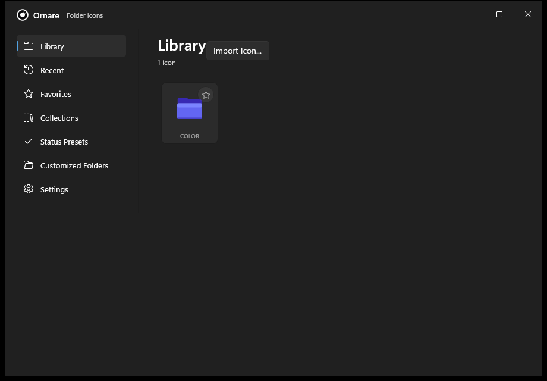
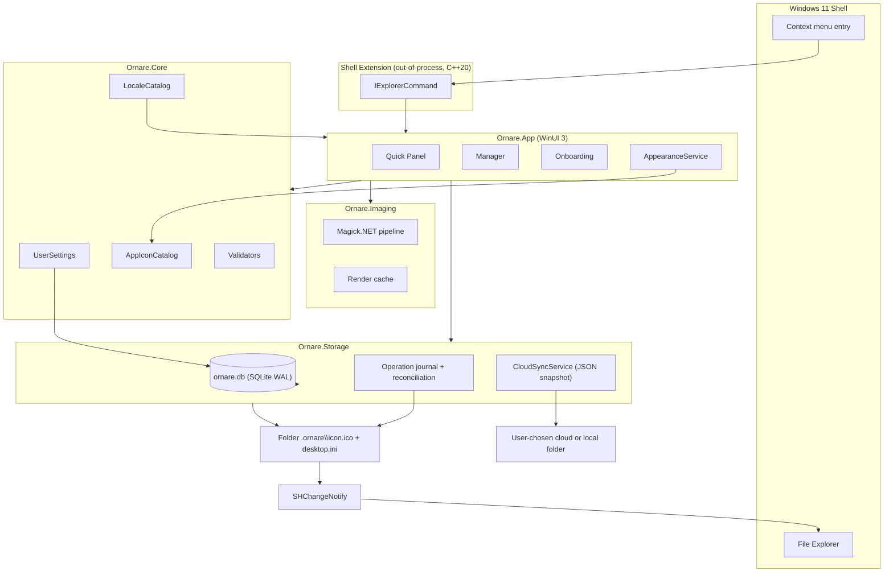
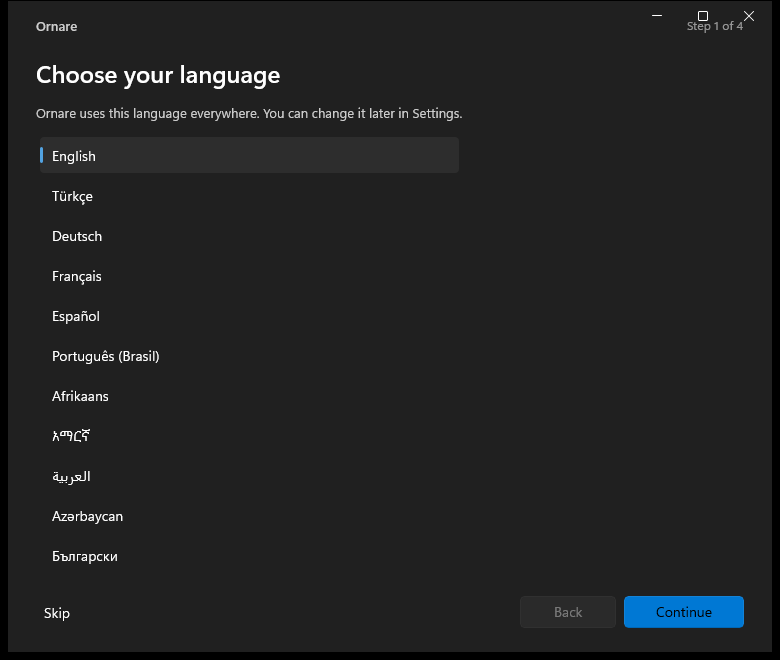
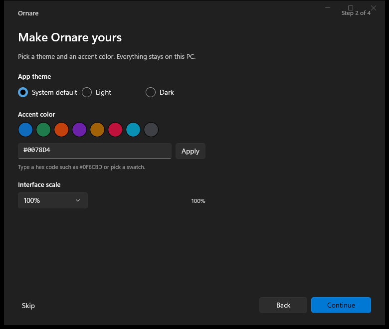
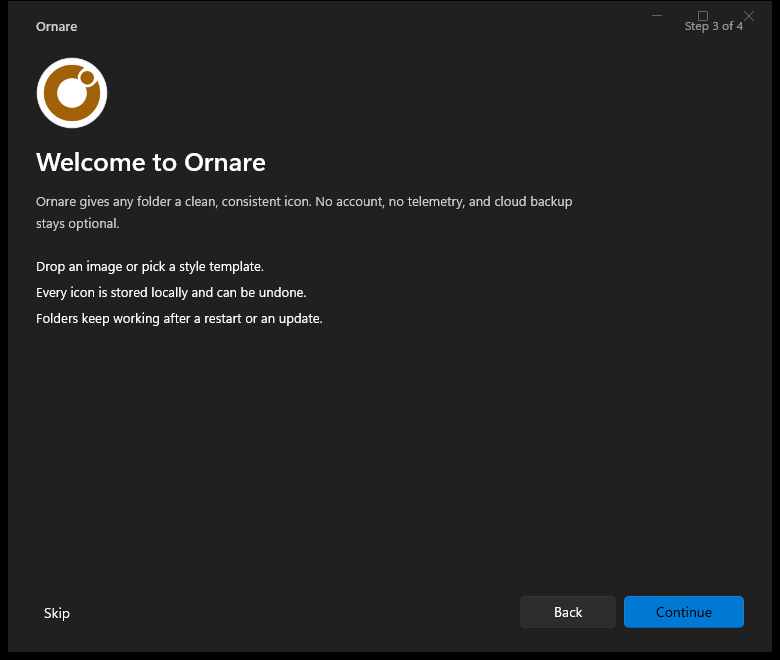
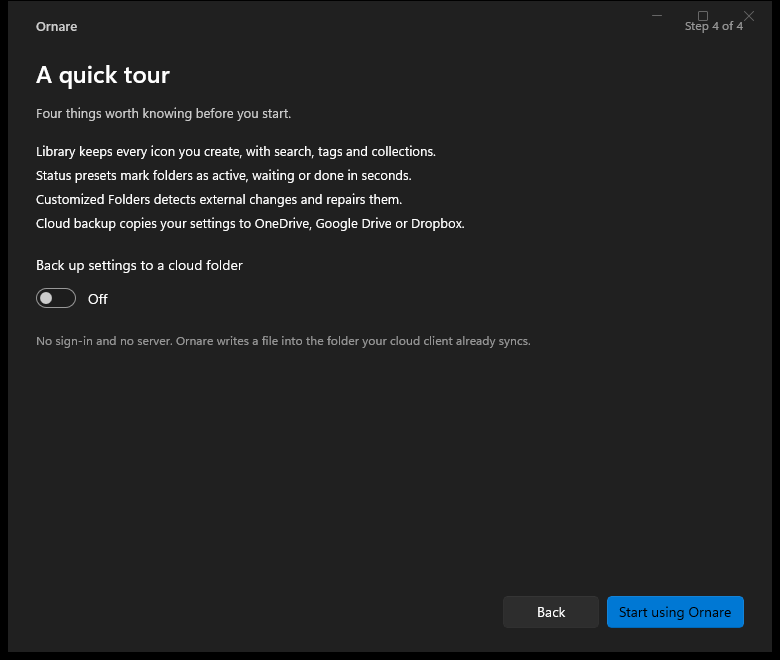
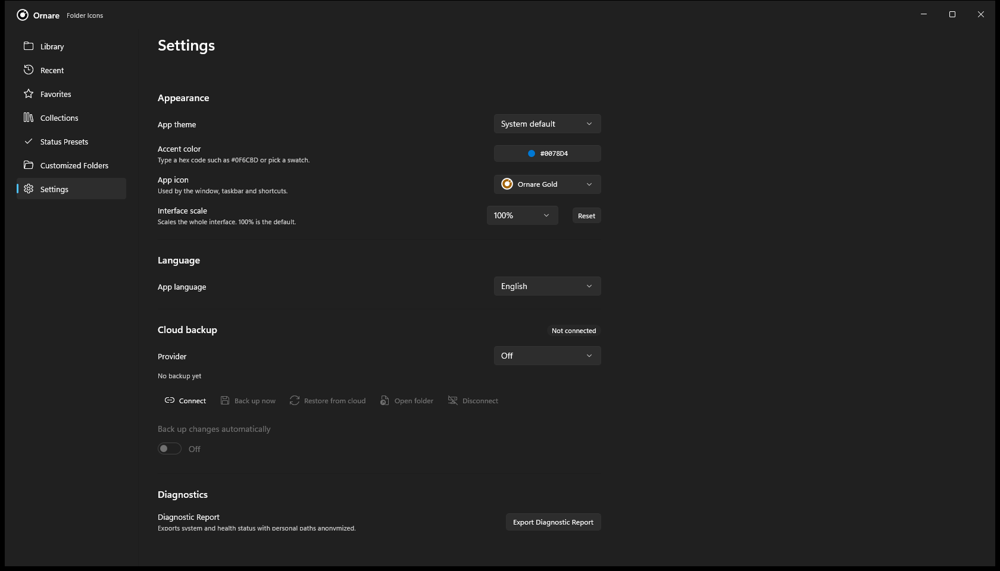
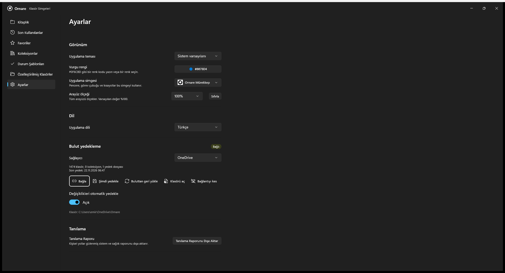
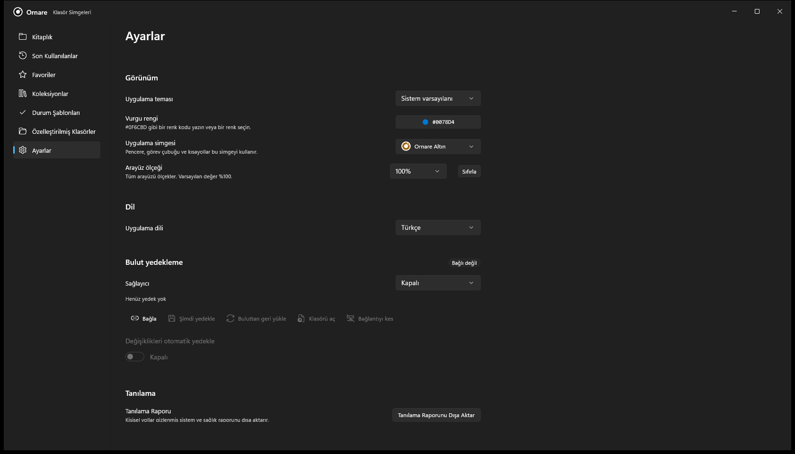

<div align="center">

<a href="https://vellium.dev" target="_blank" rel="noopener noreferrer">
  
</a>

<br /><br />

# Ornare - Native Windows 11 Folder Personalization

</div>

---

<div align="center">

[](#english-version)
&nbsp;&nbsp;&nbsp;&nbsp;
[](#turkish-version)

</div>

---

<div align="center">

[](https://github.com/emirtdede/ornare/actions/workflows/ci.yml)


</div>

---

<a id="english-version"></a>

# English Version

<div align="center">
  
  <h3>Ornare - Folder Icons, Themes and Cloud Backup for Windows 11</h3>
  <p><em>Native WinUI 3 Manager and Quick Panel, Durable Relative Icons, 8 App Icon Variants, 73-Language Catalog, and Optional User-Owned Backups</em></p>
  <p><strong>Developed &amp; Published by <a href="https://vellium.dev">Vellium</a></strong></p>
</div>

<br>

## Project Overview

**Ornare (`v1.0.0`)** is a native Windows 11 folder personalization app. It sets folder icons from images or curated emblems, keeps the result durable when folders are moved or renamed, and applies the same visual language to the whole application through themes, an accent color, eight app icon variants, and an interface scale.

Everything that matters happens on the device. There is no account, no telemetry, no advertising, no image upload and no hidden administrator requirement. The optional cloud backup writes a single JSON snapshot into a folder **you** choose (OneDrive, Google Drive, Dropbox, or any local folder) so a new PC or a clean Windows install can restore your setup.

The core interaction is one gesture:

> **Right-click a folder -> Set Folder Icon -> Drop, pick or paste an image -> Applied.**

<p align="center">
  
</p>

---

## Key Features

### Native Shell Integration
- Out-of-process C++20 COM `IExplorerCommand` shell extension registered for the Windows 11 context menu. The extension stays tiny, fails closed, and never blocks Explorer.
- Live shell refresh through `SHChangeNotify`; `explorer.exe` is never killed or restarted.
- Durable relative icon storage in a hidden `.ornare` subfolder, so an icon survives moving or renaming the folder and works across drives.

### Durable, Non-Destructive Writes
- Two-phase filesystem journal plus idempotent startup reconciliation: an interrupted apply is completed or rolled back on the next launch, never left half-written.
- Reset and Undo remove only Ornare-owned icon semantics and preserve third-party `desktop.ini` values.
- A newer external `desktop.ini` snapshot is never overwritten by a stale reset.

### Image and Emblem Pipeline
- Magick.NET pipeline for PNG, JPEG, WebP, BMP, ICO and sanitized SVG input.
- Multi-resolution ICO output (16 to 256 px) with alpha preservation and deterministic render caching.
- A curated emblem library (320 Fluent-derived SVGs with recorded provenance) plus nine folder templates for fast visual organization.

### Personalization
- **Themes:** System, Light, Dark, following the Windows theme by default.
- **Accent color:** System accent or any `#RRGGBB` value, with contrast-aware foreground calculation.
- **App icon:** 8 Ornare glyph variants (Ink, Accent, Ocean, Forest, Ember, Plum, Graphite, Gold) rendered in the accent color and applied to the window, taskbar and tray.
- **Interface scale:** 80 to 200 percent in eight presets, with a reset action.
- **Status presets:** visual badges for priority-style folder organization that never change filesystem priority or shell sorting.

### 73-Language Catalog
- 73 selectable languages, resolved from the Windows UI language on first launch with English fallback.
- The setup executable offers the same 73-language picker before anything is installed, preselects the Windows language, and passes the choice to onboarding.
- Six fully translated first-class locales: English, Turkish, German, French, Spanish, Portuguese (Brazil).
- The remaining 67 languages are selectable and resolve to English copy until their translation lands; the picker never advertises a translation that does not exist. Parity is enforced by tests.

### Four-Step Onboarding
1. Language.
2. Theme, accent color and interface scale.
3. Welcome.
4. Guided tour with the optional cloud backup opt-in.

Each step is a separate screen; the flow is shown again on demand from Settings.

### Optional Cloud Backup (User-Owned Folder)
- Provider detection: `OneDriveConsumer`, `OneDrive`, `OneDriveCommercial`, `%USERPROFILE%\OneDrive`, Google Drive, Dropbox, or any folder you pick.
- Writes `<provider root>\Ornare\ornare-cloud-sync.json` atomically (`.tmp-<pid>` + rename, copy fallback for `EBUSY`/`EPERM`).
- Keeps `ornare-cloud-previous.json` and 15 daily `ornare-backup-YYYY-MM-DD.json` snapshots.
- Corrupt-file recovery chain: current -> previous -> newest backup.
- Empty local state never overwrites a populated cloud snapshot; after a reinstall the app offers **Restore** or **Start fresh**.
- Debounced background writes (350 ms) plus a flush on close; background failures never block the UI.
- The snapshot carries portable user intent only: settings, folder assignments and collection names. Binary icon caches stay local.

### Diagnostics
- One-click diagnostic report export with anonymized personal paths.
- Runtime session log available only when `ORNARE_DIAGNOSTIC_SESSION=1` is set.

---

## Tech Stack

<div align="center">


</div>

### Runtime and UI
- **WinUI 3 / Windows App SDK** - Manager window, Quick Panel, onboarding and settings surfaces.
- **.NET 10 (C# 14)** - application, core and storage layers.
- **C++20** - out-of-process shell extension and native interop.
- **Magick.NET** - image decode, ICO composition and preview rendering.

### Data and Safety
- **SQLite (WAL)** - folder assignments, collections, settings and history.
- **Filesystem journal** - crash-safe two-phase apply with startup reconciliation.
- **`SHChangeNotify`** - shell refresh without restarting Explorer.

### Build, Test and Release
- **xUnit** - core, storage, imaging, UI-contract and integration suites, including localization parity and cloud backup recovery tests.
- **MSIX** - packaged x64 and ARM64 builds with a signed manifest.
- **GitHub Actions** - restore, build, non-performance tests, performance tests and artifact upload.

---

## Project Structure

```tree
Ornare/
├── .github/                         # CI, Dependabot, issue and PR templates
├── assets/
│   ├── emblems/                     # Curated SVG emblem library with provenance
│   └── folders/                     # Folder template SVGs with provenance
├── docs/
│   ├── adr/                         # Architecture decision records
│   ├── screenshots/                 # Runtime evidence captured from the packaged app
│   ├── ARCHITECTURE.md              # Architecture as built: layering, write funnel, storage
│   ├── COMPETITOR_COMPARISON.md     # Scored comparison with the market, and the verdict
│   ├── DEFINITION_OF_READY_DONE.md  # What "done" means for a change
│   ├── DESIGN_SYSTEM.md             # Visual language and motion rules
│   ├── LOCALIZATION.md              # 73-language catalog and fallback rules
│   ├── LOGGING_DIAGNOSTICS.md       # What is logged, where, and what is never logged
│   ├── LOGIC_INVARIANTS.md          # The INV-* registry cited by code comments
│   ├── LONG_PATH_COMPATIBILITY.md   # What is supported and why the folder path is bounded
│   ├── OSS_REUSE.md                 # Third-party provenance and licence rules
│   ├── PERFORMANCE.md               # Budgets, gates and measurement method
│   ├── QA_REPORT.md                 # Verification evidence, gates and known limits
│   ├── QUALITY_GATES.md             # The automatable gates and their thresholds
│   ├── REQUIREMENTS_TRACEABILITY.md # Requirement -> code -> test mapping
│   ├── SECURE_SDLC.md               # Security practices applied to the build
│   └── THREAT_MODEL.md              # Assets, attackers and mitigations
├── scripts/                         # Build, packaging, quality gate and release helpers
├── src/
│   ├── Ornare.App/                  # WinUI 3 Manager, Quick Panel, onboarding, resources
│   ├── Ornare.Cli/                  # Automation entry point for apply, reset and diagnostics
│   ├── Ornare.Core/                 # Domain models, locale catalog, settings, validation
│   ├── Ornare.DesignSystem/         # Shared brushes, typography and motion tokens
│   ├── Ornare.Installer/            # Native C++ setup executable with the 73-language picker
│   ├── Ornare.Storage/              # SQLite storage, journal and cloud snapshot service
│   ├── Ornare.Imaging/              # Image pipeline, ICO composition and render cache
│   ├── Ornare.ShellExtension/       # C++20 IExplorerCommand implementation
│   └── Ornare.Windows/              # Native interop and shell helpers
├── tests/                           # Core, storage, imaging, UI and integration suites
├── Ornare.slnx                      # Solution
└── Directory.Build.props            # Warnings as errors and shared analyzers
```

---

## Architecture



**Safety model.** Icon writes go through a journaled two-phase apply, so a crash can only produce a resumable state, never a corrupted folder. Shell notifications are the only Explorer interaction: no process termination, no registry hacks, no in-process injection. The shell extension is out-of-process and fails closed, so a defect in the extension cannot take Explorer down. Cloud backup is strictly additive: it reads Ornare state and writes a JSON file inside a folder the user chose, with no credentials and no network API.

---

## Storage and Data Boundaries

| Path | Protection | Contents |
| :--- | :--- | :--- |
| `%LOCALAPPDATA%\Ornare\ornare.db` | SQLite WAL, transactional writes | Folder assignments, collections, settings, recent items |
| `<folder>\.ornare\icon.ico` | Hidden, relative path | Durable folder icon |
| `<folder>\desktop.ini` | Owned-semantics merge | Only Ornare-owned icon keys are touched |
| `<cloud root>\Ornare\ornare-cloud-sync.json` | Atomic write + validation | Portable settings, folder and collection metadata |
| `<cloud root>\Ornare\ornare-cloud-previous.json` | Rotated on each write | Previous good snapshot |
| `<cloud root>\Ornare\ornare-backup-YYYY-MM-DD.json` | 15-day rotation | Daily snapshots |
| `%LOCALAPPDATA%\Ornare\diagnostics\` | Opt-in only | Session log when explicitly enabled |

---

## Screenshots

<p align="center">
  
  
</p>
<p align="center">
  
  
</p>
<p align="center">
  
</p>
<p align="center">
  
</p>

---

## Installation and Usage

### Install with the setup file

1. Download `OrnareSetup 1.0.0.exe` (or build it locally, see below).
2. Run the setup. No administrator prompt is required; the package is deployed per user.
3. Pick your language on the first screen: all 73 languages are listed, the Windows UI language is preselected, and English is used when nothing matches.
4. Leave **Create a desktop shortcut** checked if you want one.
5. Select **Install**, then open **Ornare** from the Start menu. The first run opens the four-step onboarding in the language you chose during setup.

**Uninstall:** Windows Settings -> Apps -> Ornare -> Uninstall. Folder icons already applied stay in place unless you reset them, because the app never deletes user files during uninstall.

### Build from source

Requirements: Windows 11 (25H2 baseline), .NET 10 SDK, Visual Studio 2022 with the Windows App SDK and C++ desktop workloads, and PowerShell 7.

```powershell
git clone https://github.com/emirtdede/ornare.git
cd ornare

# Restore and build
dotnet build Ornare.slnx -c Release

# Tests
dotnet test Ornare.slnx -c Release --filter "Category!=Performance&Category!=InstalledPackage"
dotnet test Ornare.slnx -c Release --filter "Category=Performance"

# The one test that needs the package installed and signed
pwsh ./scripts/quality-gate.ps1 -InstalledPackageOnly

# Package
pwsh ./scripts/create-package.ps1
```

### Quality gates

```powershell
pwsh ./scripts/quality-gate.ps1      # build plus full test run
pwsh ./scripts/dependency-audit.ps1  # vulnerable and deprecated packages
```

---

## Distribution

- **MSIX package** - packaged x64 and ARM64 builds with package identity, produced by the release scripts.
- **Source tag** - `v1.0.0`.
- **Release notes** - see [`CHANGELOG.md`](CHANGELOG.md) and [GitHub Releases](https://github.com/emirtdede/ornare/releases).

---

## License and Publisher

**Proprietary software.** Copyright © 2026 Vellium Teknoloji Anonim Şirketi. All rights reserved.

No rights are granted to copy, modify, publish, distribute, sublicense, or sell the software except under a separate written agreement with Vellium Teknoloji Anonim Şirketi. See [`LICENSE.md`](LICENSE.md) for the full terms and [`THIRD-PARTY-NOTICES.md`](THIRD-PARTY-NOTICES.md) for open-source attributions.

- **Publisher:** Vellium Teknoloji Anonim Şirketi
- **Website:** [vellium.dev](https://vellium.dev)
- **Security disclosure:** [SECURITY.md](SECURITY.md)

---

<br>

---

<a id="turkish-version"></a>

# Türkçe Versiyon

<div align="center">
  
  <h3>Ornare - Windows 11 İçin Klasör Simgeleri, Temalar ve Bulut Yedekleme</h3>
  <p><em>Yerel WinUI 3 Yönetici ve Hızlı Panel, Kalıcı Göreli Simgeler, 8 Uygulama Simgesi Varyantı, 73 Dil Kataloğu ve İsteğe Bağlı Kullanıcı Sahipli Yedekleme</em></p>
  <p><strong>Geliştirici ve Yayıncı: <a href="https://vellium.dev">Vellium</a></strong></p>
</div>

<br>

## Proje Genel Bakışı

**Ornare (`v1.0.0`)**, Windows 11 için yerel bir klasör kişiselleştirme uygulamasıdır. Klasör simgelerini görsellerden veya hazır amblemlerden oluşturur, klasör taşınsa ya da adı değişse bile simgenin kalıcı kalmasını sağlar ve aynı görsel dili tema, vurgu rengi, sekiz uygulama simgesi varyantı ve arayüz ölçeğiyle tüm uygulamaya uygular.

Önemli olan her şey cihazda gerçekleşir. Hesap yoktur, telemetri yoktur, reklam yoktur, görsel yüklemesi yoktur ve gizli yönetici izni istenmez. İsteğe bağlı bulut yedekleme, **sizin seçtiğiniz** bir klasöre (OneDrive, Google Drive, Dropbox veya herhangi bir yerel klasör) tek bir JSON anlık görüntüsü yazar; böylece yeni bir bilgisayarda veya temiz Windows kurulumunda ayarlarınızı geri yükleyebilirsiniz.

Temel etkileşim tek bir hareketle tamamlanır:

> **Klasöre sağ tıklayın -> Klasör Simgesini Ayarla -> Görseli bırakın, seçin veya yapıştırın -> Uygulandı.**

<p align="center">
  
</p>

---

## Öne Çıkan Özellikler

### Yerel Kabuk Entegrasyonu
- Windows 11 bağlam menüsü için süreç dışı C++20 COM `IExplorerCommand` kabuk eklentisi. Eklenti küçük kalır, hatada güvenli tarafa kapanır ve Explorer'ı asla kilitlemez.
- `SHChangeNotify` ile canlı kabuk yenilemesi; `explorer.exe` asla sonlandırılmaz veya yeniden başlatılmaz.
- Gizli `.ornare` alt klasöründe göreli simge saklama; simge, klasör taşınsa veya adı değişse de çalışır, sürücüler arasında geçerlidir.

### Kalıcı ve Yıkıcı Olmayan Yazma
- İki fazlı dosya sistemi günlüğü ve açılışta idempotent uzlaştırma: yarıda kalan uygulama işlemi bir sonraki açılışta tamamlanır veya geri alınır.
- Sıfırlama ve Geri Al yalnızca Ornare'a ait simge anahtarlarını kaldırır, üçüncü taraf `desktop.ini` değerlerini korur.
- Dışarıdan güncellenmiş yeni bir `desktop.ini` anlık görüntüsü, eski bir sıfırlama ile asla ezilmez.

### Görsel ve Amblem Hattı
- PNG, JPEG, WebP, BMP, ICO ve arındırılmış SVG girişleri için Magick.NET hattı.
- 16 ile 256 piksel arası çok çözünürlüklü ICO çıktısı, alfa koruması ve deterministik render önbelleği.
- Kaynağı belgelenmiş 320 Fluent türevi SVG amblem kitaplığı ve hızlı görsel düzenleme için dokuz klasör şablonu.

### Kişiselleştirme
- **Temalar:** Sistem, Açık, Koyu; varsayılan olarak Windows temasını izler.
- **Vurgu rengi:** Sistem vurgusu veya herhangi bir `#RRGGBB` değeri; kontrast uyumlu ön plan rengi hesaplanır.
- **Uygulama simgesi:** Vurgu rengiyle üretilen 8 Ornare glif varyantı (Ink, Accent, Ocean, Forest, Ember, Plum, Graphite, Gold); pencere, görev çubuğu ve sistem tepsisi simgesine uygulanır.
- **Arayüz ölçeği:** Sekiz ön ayarla yüzde 80 ile 200 arası, sıfırlama düğmesiyle.
- **Durum şablonları:** Öncelik benzeri klasör düzenlemesi için görsel rozetler; dosya sistemi önceliğini veya kabuk sıralamasını değiştirmez.

### 73 Dil Kataloğu
- 73 seçilebilir dil; ilk açılışta Windows arayüz dilinden çözümlenir, eşleşme yoksa İngilizce kullanılır.
- Kurulum dosyası, hiçbir şey kurulmadan önce aynı 73 dilli seçiciyi sunar, Windows dilini önceden seçer ve seçimi ilk kuruluma aktarır.
- Tam çevrilmiş birinci sınıf altı dil: İngilizce, Türkçe, Almanca, Fransızca, İspanyolca, Portekizce (Brezilya).
- Kalan 67 dil seçilebilir ve çevirisi tamamlanana kadar İngilizce metne düşer; seçici, var olmayan bir çeviriyi asla vaat etmez. Parite testlerle zorunludur.

### Dört Adımlı İlk Kurulum
1. Dil.
2. Tema, vurgu rengi ve arayüz ölçeği.
3. Karşılama.
4. İsteğe bağlı bulut yedekleme onayıyla birlikte uygulama tanıtımı.

Her adım ayrı bir ekrandır; akış Ayarlar'dan istenildiğinde yeniden gösterilebilir.

### İsteğe Bağlı Bulut Yedekleme (Kullanıcı Sahipli Klasör)
- Sağlayıcı algılama: `OneDriveConsumer`, `OneDrive`, `OneDriveCommercial`, `%USERPROFILE%\OneDrive`, Google Drive, Dropbox veya seçtiğiniz herhangi bir klasör.
- `<sağlayıcı kökü>\Ornare\ornare-cloud-sync.json` dosyasına atomik yazma (`.tmp-<pid>` + rename, `EBUSY`/`EPERM` için kopyalama yedeği).
- `ornare-cloud-previous.json` ve 15 günlük `ornare-backup-YYYY-MM-DD.json` anlık görüntüleri.
- Bozuk dosya kurtarma zinciri: güncel -> önceki -> en yeni yedek.
- Boş yerel veri, dolu bulut anlık görüntüsünün üzerine asla yazmaz; yeniden kurulum sonrasında uygulama **Geri Yükle** veya **Yeni Başlangıç** seçeneği sunar.
- 350 ms gecikmeli arka plan yazımı ve kapanışta zorunlu gönderim; arka plan hataları arayüzü bloklamaz.
- Anlık görüntü yalnızca taşınabilir kullanıcı niyetini taşır: ayarlar, klasör kayıtları ve koleksiyon adları. İkili simge önbelleği yerelde kalır.

### Tanılama
- Kişisel yolları anonimleştiren tek tıkla tanılama raporu dışa aktarma.
- Yalnızca `ORNARE_DIAGNOSTIC_SESSION=1` ayarlandığında yazılan çalışma oturumu günlüğü.

---

## Teknoloji Yığını

- **WinUI 3 / Windows App SDK** - Yönetici penceresi, Hızlı Panel, ilk kurulum ve ayarlar yüzeyleri.
- **.NET 10 (C# 14)** - uygulama, çekirdek ve depolama katmanları.
- **C++20** - süreç dışı kabuk eklentisi ve yerel birlikte çalışma.
- **Magick.NET** - görsel çözme, ICO birleştirme ve önizleme üretimi.
- **SQLite (WAL)** - klasör kayıtları, koleksiyonlar, ayarlar ve geçmiş.
- **xUnit** - çekirdek, depolama, görsel, arayüz sözleşmesi ve entegrasyon testleri.

---

## Kurulum ve Kullanım

### Paketten kurulum

1. `OrnareSetup 1.0.0.exe` dosyasını indirin (veya aşağıdaki adımlarla yerel olarak derleyin).
2. Kurulumu çalıştırın. Yönetici izni istenmez; paket kullanıcı bazında kurulur.
3. İlk ekranda dilinizi seçin: 73 dilin tamamı listelenir, Windows arayüz dili önceden seçilir, eşleşme yoksa İngilizce kullanılır.
4. Masaüstü kısayolu istiyorsanız **Masaüstünde kısayol oluştur** seçili kalsın.
5. **Kur** düğmesine basın, ardından **Ornare** uygulamasını Başlat menüsünden açın. İlk çalıştırmada dört adımlı kurulum, kurulum sırasında seçtiğiniz dilde açılır.

**Kaldırma:** Windows Ayarlar -> Uygulamalar -> Ornare -> Kaldır. Kaldırma sırasında kullanıcı dosyaları silinmediği için daha önce uygulanmış klasör simgeleri, siz sıfırlamadıkça yerinde kalır.

### Kaynaktan derleme

Gereksinimler: Windows 11 (25H2 temel çizgisi), .NET 10 SDK, Windows App SDK ve C++ masaüstü iş yükleriyle Visual Studio 2022 ve PowerShell 7.

```powershell
git clone https://github.com/emirtdede/ornare.git
cd ornare

dotnet build Ornare.slnx -c Release

dotnet test Ornare.slnx -c Release --filter "Category!=Performance&Category!=InstalledPackage"
dotnet test Ornare.slnx -c Release --filter "Category=Performance"

# Paketi kurulu makinede çalışan tek test
pwsh ./scripts/quality-gate.ps1 -InstalledPackageOnly

pwsh ./scripts/create-package.ps1
```

### Kalite kapıları

```powershell
pwsh ./scripts/quality-gate.ps1
pwsh ./scripts/dependency-audit.ps1
```

---

## Ekran Görüntüleri

<p align="center">
  
  
</p>
<p align="center">
  
</p>

---

## Lisans ve Yayıncı

**Tescilli yazılım.** Telif hakkı © 2026 Vellium Teknoloji Anonim Şirketi. Tüm hakları saklıdır.

Vellium Teknoloji Anonim Şirketi ile ayrı bir yazılı anlaşma olmadan yazılımı kopyalama, değiştirme, yayınlama, dağıtma, alt lisanslama veya satma hakkı verilmez. Tam koşullar için [`LICENSE.md`](LICENSE.md), açık kaynak bildirimleri için [`THIRD-PARTY-NOTICES.md`](THIRD-PARTY-NOTICES.md) dosyasına bakın.

- **Yayıncı:** Vellium Teknoloji Anonim Şirketi
- **Web sitesi:** [vellium.dev](https://vellium.dev)
- **Güvenlik bildirimi:** [SECURITY.md](SECURITY.md)
