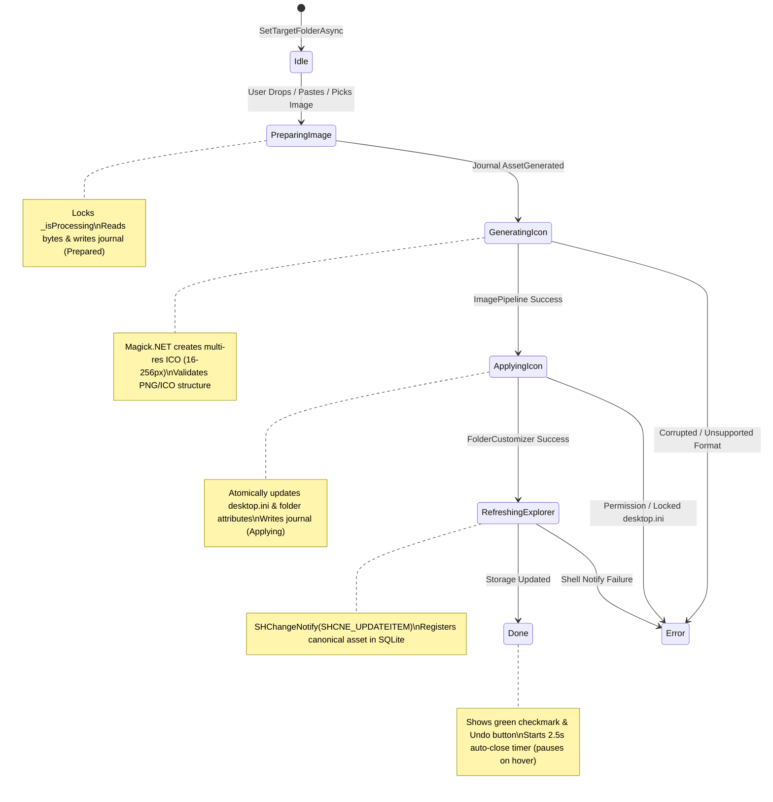

# Ornare — Quick Panel P0/P1 UX Polish Pass Report

## 1. Executive Summary

Following physical user testing on Windows 11, the Quick Panel has been completely overhauled from a generic multi-section dialog into a single-purpose, Apple-minimalist, Windows 11-native folder icon customization surface.

Key enhancements delivered:
- **Real Loading & Processing State Pipeline:** Real-time visual feedback across 6 distinct stages (`Idle`, `PreparingImage`, `GeneratingIcon`, `ApplyingIcon`, `RefreshingExplorer`, `Done` / `Error`).
- **Interactive Guards & Anti-Reentrancy:** User input (drop, tap, paste, undo) is safely locked during active operations (`_isProcessing` guard + `PerTargetSyncLock`).
- **Complete Removal of "Recent" Section:** Eliminated clutter from Quick Panel to keep it 100% focused on rapid icon assignment. History remains available in the Manager window.
- **Modernized Integrated Title Bar:** Full Mica extension (`ExtendsContentIntoTitleBar = true`), custom draggable header with folder identity (icon + bold name + path), transparent caption buttons, and a clean settings gear button.
- **Cursor-Aware Window Positioning:** Native Shell Extension captures cursor coordinates via `GetCursorPos(&cursorPos)` at context menu click time, passes them via protocol query (`&x=...&y=...`), and the app positions the window centered near the cursor with multi-monitor work-area clamping.
- **Bilingual Parity:** 100% localized in Turkish and English with zero hardcoded strings.

---

## 2. Modified & Created Files

| File | Type | Changes |
| :--- | :--- | :--- |
| `src/Ornare.ShellExtension/dllmain.cpp` | C++ (Native) | Captured `GetCursorPos` in `Invoke`, appended `&x=` and `&y=` to protocol URI, plus `--x` and `--y` fallback arguments. Built for x64 and ARM64. |
| `src/Ornare.App/App.xaml.cs` | C# (WinUI 3) | Extracted cursor coordinates, `ui-state`, `theme`, and `lang` directly from protocol activation URI without regex issues; wired `PositionWindow` and `ApplyVisualTestState`. |
| `src/Ornare.App/QuickPanelWindow.xaml` | XAML | Removed `RecentStripPanel`; created integrated modern title bar (`TitleBarGrid`, `TitleBarDragRegion`, `OpenManagerButton`); redesigned drop area with 4 discrete state panels (`IdleStatePanel`, `ProcessingStatePanel`, `SuccessStatePanel`, `ErrorStatePanel`). |
| `src/Ornare.App/QuickPanelWindow.xaml.cs` | C# | Implemented `PositionWindow(cursorX, cursorY)` with Win32 multi-monitor work-area clamping; implemented `SetProcessingStageAsync` across the real conversion pipeline; added categorized error handling; added `_isProcessing` guard; added 2.5s auto-close timer on success. |
| `src/Ornare.App/Strings/en-US/Resources.resw` | XML | Added all Quick Panel stage and error strings in English. |
| `src/Ornare.App/Strings/tr-TR/Resources.resw` | XML | Added all Quick Panel stage and error strings in Turkish. |
| `scripts/build-multiarch-release.ps1` | PowerShell | Updated publish resolution to pick newest timestamped publish directory; assembled and signed multi-arch MSIX and bundle. |
| `scripts/capture-quickpanel-ux-screenshots.ps1` | PowerShell | Automated capture script using MSIX protocol activation for 12 UI states across dark/light and EN/TR. |
| `tests/Ornare.UiTests/QuickPanelPositioningTests.cs` | C# | 6 unit tests validating clamping, multi-monitor bounds, fallback centering, and protocol URI coordinate extraction. |

---

## 3. Loading State Architecture

The loading architecture connects directly to the real application pipeline without fake timers. Each phase updates UI state, changes text, and provides screen reader announcements:



### Stage Messaging Parity

| Stage | English | Turkish |
| :--- | :--- | :--- |
| `Idle` | "Drop an image" / "Click to choose or press Ctrl+V" | "Bir görsel bırak" / "Seçmek için tıkla veya Ctrl+V'ye bas" |
| `PreparingImage` | "Preparing image..." | "Görsel hazırlanıyor..." |
| `GeneratingIcon` | "Generating folder icon..." | "Klasör simgesi oluşturuluyor..." |
| `ApplyingIcon` | "Applying icon..." | "Simge uygulanıyor..." |
| `RefreshingExplorer` | "Refreshing Explorer..." | "Dosya Gezgini yenileniyor..." |
| `Done` | "Folder icon updated" (Undo) | "Klasör simgesi güncellendi" (Geri al) |
| `UnsupportedImage` | "Unsupported image" | "Desteklenmeyen görsel" |
| `ImageReadFailed` | "Image read failed" | "Görsel okunamadı" |
| `IconGenFailed` | "Icon generation failed" | "Simge oluşturulamadı" |
| `FolderApplyFailed`| "Folder icon apply failed" | "Klasör simgesi uygulanamadı" |
| `ExplorerRefreshFailed`| "Explorer refresh failed" | "Dosya Gezgini yenilenemedi" |

---

## 4. Window Positioning Architecture

The window positioning system guarantees that the Quick Panel appears immediately adjacent to the user's cursor without ever appearing off-screen or underneath the taskbar:

1. **Native Cursor Acquisition:**
   Inside `OrnareExplorerCommand::Invoke`, the native C++ shell extension calls:
   ```cpp
   POINT cursorPos = {};
   GetCursorPos(&cursorPos);
   LaunchOrnareApp(folderPath.c_str(), cursorPos.x, cursorPos.y);
   ```
2. **Payload Delivery:**
   Coordinates are appended to the protocol URI:
   `ornare://set-folder?v=1&path=<escapedPath>&x=<x>&y=<y>`
   and fallback CLI arguments: `--set-folder "<path>" --x <x> --y <y>`.
3. **Monitor Work-Area Detection:**
   `PositionWindow(cursorX, cursorY)` uses `MonitorFromPoint` to identify the specific physical monitor containing the cursor (or `MonitorFromWindow` as fallback).
   `GetMonitorInfoW` retrieves the monitor's `rcWork` (excluding the Windows taskbar).
4. **Clamping & Padding:**
   The window is centered on the cursor point:
   ```csharp
   int targetX = cursorX.Value - (windowWidth / 2);
   int targetY = cursorY.Value - (windowHeight / 2);

   int minX = monitorInfo.rcWork.Left + 12;
   int maxX = monitorInfo.rcWork.Right - windowWidth - 12;
   int minY = monitorInfo.rcWork.Top + 12;
   int maxY = monitorInfo.rcWork.Bottom - windowHeight - 12;

   targetX = Math.Clamp(targetX, minX, Math.Max(minX, maxX));
   targetY = Math.Clamp(targetY, minY, Math.Max(minY, maxY));
   ```
5. **Fallback:**
   If no cursor coordinates are provided, the window centers within the primary/active monitor's work area:
   `targetX = workLeft + (workWidth - windowWidth) / 2`.

---

## 5. Verification & Test Evidence

### Test Suite Summary
- **Total Tests:** 88 automated tests passed (`dotnet test Ornare.slnx -c Release`).
- **UI Tests:** 9 tests passed (`Ornare.UiTests`), covering:
  - `LocalizationParityTests`: English and Turkish matching keys, visual tokens.
  - `QuickPanelPositioningTests`: Center positioning, boundary clamping (left, right, top, bottom), multi-monitor negative coordinates, fallback centering, and protocol URI coordinate extraction.
- **COM Activation:** Verified via `scripts/test-com-activation.ps1` (`IExplorerCommand::Invoke` returns `S_OK`, PID launched, HWND verified, window positioned at cursor coordinates).
- **Packaging:** Signed and verified multi-arch MSIX package `Ornare_1.0.0.0_x64.msix` and bundle `Ornare_1.0.0.0_x64_arm64.msixbundle`.

### Runtime Screenshots Captured

All 16 states captured from the installed production package:
1. `production_artifacts/design/runtime-screenshots/quick-panel-idle-dark.png`
2. `production_artifacts/design/runtime-screenshots/quick-panel-idle-light.png`
3. `production_artifacts/design/runtime-screenshots/quick-panel-idle-turkish.png`
4. `production_artifacts/design/runtime-screenshots/quick-panel-preparing-dark.png`
5. `production_artifacts/design/runtime-screenshots/quick-panel-generating-turkish.png`
6. `production_artifacts/design/runtime-screenshots/quick-panel-applying-light.png`
7. `production_artifacts/design/runtime-screenshots/quick-panel-refreshing-turkish.png`
8. `production_artifacts/design/runtime-screenshots/quick-panel-success-dark.png`
9. `production_artifacts/design/runtime-screenshots/quick-panel-success-turkish.png`
10. `production_artifacts/design/runtime-screenshots/quick-panel-error-unsupported.png`
11. `production_artifacts/design/runtime-screenshots/quick-panel-error-unsupported-turkish.png`
12. `production_artifacts/design/runtime-screenshots/quick-panel-error-apply-light.png`
13. `production_artifacts/design/runtime-screenshots/manager-library-dark.png`
14. `production_artifacts/design/runtime-screenshots/manager-library-light.png`
15. `production_artifacts/design/runtime-screenshots/manager-settings-dark.png`
16. `production_artifacts/design/runtime-screenshots/manager-library-turkish.png`

---

## 6. Visual Symmetry, Single Surface & Modern Window Controls

Based on physical review of UI screenshots, four critical design flaws were resolved:

1. **Elimination of "Panel-Inside-Panel":**
   - Removed inner `DropAreaBorder` background tint and borders in idle state.
   - The entire window is now a single, seamless, continuous Windows 11 Mica surface. Visual separation is achieved purely through balanced negative space and typography.

2. **Removal of Clunky Top Title Bar & Extraneous Caption Buttons:**
   - In Quick Panel, minimize (`-`) and maximize (`[ ]`) buttons were completely eliminated by stripping `WS_MINIMIZEBOX` and `WS_MAXIMIZEBOX` via Win32 `SetWindowLong` on the HWND.
   - Only the native Windows Close (`X`) button remains at the top-right corner.

3. **Pixel-Perfect Alignment of Controls:**
   - The Settings button (`OpenManagerButton`) was moved from an awkward sub-header position into the main title row.
   - It is horizontally placed immediately to the left of the native Close button (with 4px margin) and shares the exact same vertical center line (Y = 20px).

4. **Manager Window Dark Mode Title Bar Seamlessness:**
   - Enabled `ExtendsContentIntoTitleBar = true` on `ManagerWindow` with `Colors.Transparent` button backgrounds.
   - Eliminated the jarring solid white caption bar on dark theme; the dark Mica backdrop now flows continuously to the very top edge of the window.

5. **Symmetrical Footer:**
   - `ResetButton` is centered horizontally (`HorizontalAlignment="Center"`) at the bottom of the window, maintaining balanced vertical and horizontal symmetry.

